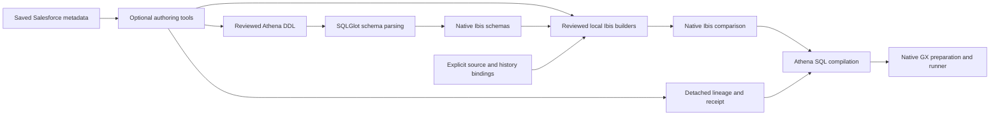

# Athena DDL and standalone query design review

Reviewed October 27, 2026. This document records the original design review and
accepted migration plan against the pinned baseline below. The user subsequently
authorized implementation; see [implementation and review](standalone-implementation-review.md)
for the completed changes, review fixes and current verification.

## Decision

Replace ODCS with Athena DDL as the input-type authority. Keep executable
transformations in reviewed, locally owned Ibis functions. Use `ppsc-salesforce`
as an optional offline authoring tool for field definitions, Flow expressions,
reference SQL and source evidence. Installing, importing, testing and running
Ops must not require either `salesforce` or the older `ppsc_metadata` compiler.

This is stronger than the current independence claim. Ops already avoids the
Salesforce application package, but still interprets Salesforce metadata at
runtime through an independently installable vendored compiler.



The authoring arrows describe reviewable handoffs. They do not imply that the
current producer automatically emits executable Python, or that Ops executes
saved SQL files.

## Evidence and scope

- Ops HEAD: `42a2094057002965ab74b7bf1f47cf5709b69040`.
- Salesforce HEAD: `a534c63353680e41d12e3b55997a125ba703c675`.
- Also inspected Salesforce's uncommitted field-schema changes, new analysis and
  catalog modules, and Flow analysis consumer/developer guides. These changes
  are a working tree, not a reproducible published release.
- Ops initially had an untracked `.agents/` directory. Its design reference was
  read, and its contents were left unchanged.
- Two agents independently reviewed the current architecture. Their findings
  appear separately below; the migration plan is the primary reviewer's synthesis.

The review covers current design rather than a diff against an arbitrary older
commit. The user's request supplies the target requirements.

## What the latest Salesforce interface actually supplies

| Implemented entry point | Native result | Appropriate use here |
| --- | --- | --- |
| `salesforce.entities.field_definitions.schemas.to_sqlglot(field, source=...)` | One annotated SQLGlot `ColumnDef` | Produce selected field declarations; authoring orchestration assembles table DDL |
| `salesforce.entities.flows.queries.flow_context(...)` | Ibis table | Resolve selected lookups and formulas over explicit inputs during authoring/reference checks |
| `flow_assignments(...)` | Dictionary of Ibis values | Inspect expected values and independent assignment/determinism evidence |
| `flow_queries(...)` | Dictionary of named Ibis tables | Inspect lookup, context and expected stages from the same compiler |
| `flow_lineage(..., source=...)` | Per-field evidence dictionaries | Produce detached source pointers, fragments, dependencies and branch evidence |
| `salesforce.entities.field_definitions.rollups.rollup_values(...)` | Ibis table | Reference supported native COUNT/SUM/MIN/MAX with explicit empty-result policy |

Relevant implementations are [field schemas](../../ppsc-salesforce/src/salesforce/entities/field_definitions/schemas.py),
[Flow queries](../../ppsc-salesforce/src/salesforce/entities/flows/queries.py),
[rollups](../../ppsc-salesforce/src/salesforce/entities/field_definitions/rollups.py)
and [provenance](../../ppsc-salesforce/src/salesforce/core/provenance.py).
Sibling-repository links require that checkout beside Ops.

The current producer's `flow_assignments()` returns keys such as
`expected__FIELD`, `expected__FIELD__assigned` and
`expected__FIELD__deterministic`. Ops's old compiler returns an object with
`.expressions`, `.assigned` and `.deterministic`. Changing imports alone is
incompatible, besides retaining an unwanted producer dependency.

The new consumer guide explicitly labels `analyze_flow`, `select_projection`
and `project_flow` as proposals. New analysis/catalog code does not establish
that this prepared query interface is available. Base the immediate migration
on implemented entry points, and pin a committed producer revision when creating
accepted artifacts.

The producer's dictionary queries are logical templates. They do not select
BEFORE/AFTER histories, deletion policy, event eligibility, org-local execution
dates or physical lake versions. These remain explicit application decisions.

## Alternatives considered

| Approach | Benefit | Cost or limitation | Assessment |
| --- | --- | --- | --- |
| Independent runtime compiler plus DDL | Automatic interpretation of newly selected metadata; already avoids the Salesforce application dependency | Ops still depends on compiler distribution, behavior and evidence types | Valid if independently distributed compiler reuse is desired; does not meet the stronger producer-only requirement |
| Reviewed local Ibis builders plus DDL | Standalone execution, native composability, existing GX/runtime path | Flow changes require reviewed code regeneration; reference parity is useful but cannot replace independent expected results | Recommended for this request |
| Generated SQL as the execution handoff | Portable text with a natural producer output | Needs a typed parameter/lineage format and SQL execution loader that this repository explicitly defers | Revisit only after the authored-SQL contract is agreed |
| Automatic Ibis-to-Python emission | Could preserve producer semantics without a runtime compiler | Experimental decompilation fails on the current projections; needs emitter work and semantic round-trip checks | Future option, not a prerequisite for this migration |

Directly authored `ibis.Schema` would be simpler if SQL interchange had no use.
DDL is appropriate here because it is the requested reviewable input artifact.
Generic library functions should still accept native Ibis tables/schemas; DDL
need not become a mandatory file format for every caller.

## Standards: independent reviewer 1

1. **P1: Schema replacement alone leaves the runtime compiler dependency.**
   [pyproject.toml](../pyproject.toml),
   [domain queries](../src/ppsc_ops_data_quality/account_to_survey_results/queries.py)
   and [metadata](../src/ppsc_ops_data_quality/account_to_survey_results/metadata.py)
   require the old compiler for expressions, lineage and receipts. Move
   Salesforce interpretation to offline authoring. Keep reviewed local Ibis
   builders; copying the entire compiler would create a new maintenance burden.
2. **P1: Expression generation is not a portable code handoff.** The producer
   returns ColumnDefs and Ibis expressions, not an independently executable
   Python module. Use these outputs to support authoring and semantic reference
   checks. A saved-SQL execution handoff would conflict with the repository's
   explicit deferral of authored SQL execution.
3. **P1: Native field types do not certify deployed Athena schemas.** Preserve
   exact identifiers, nullable raw fields, numeric precision and timestamp
   semantics in selected input profiles. Own physical aliases and history
   columns in Ops, and verify the actual catalog separately.
4. **P2: Application defaults remain in core.**
   `core/queries/history.py` (removed during migration)
   imports Account, Contact and Survey Result schemas. Move those defaults and
   schema profiles into the domain module. Keep generic DDL conversion, snapshots
   and [comparison](../src/ppsc_ops_data_quality/core/comparison.py) in core.
   This follows the documented requirement to keep core domain-independent.
5. **P2: ODCS removal must preserve reproducibility.** Replace
   `expected_value_contract()` and its suite payload with a validated receipt
   plus explicit projection lineage. Hash schema/code artifacts and retain native
   source identity. SQL comments are summaries, not structured lineage storage.

Reviewer 1 found five architectural issues; its most consequential issue is
retaining runtime metadata interpretation after replacing only the schema input.

## Spec: independent reviewer 2

1. **P1: Producer-only integration requires removing more than ODCS imports.**
   `sources/salesforce.py` (removed during migration)
   requires `MetadataBundle`, contract inspection and compiler calls, and
   [GX suite construction](../src/ppsc_ops_data_quality/account_to_survey_results/gx.py)
   embeds the derived ODCS contract. Locally owned builders and detached evidence
   are necessary for the requested stronger standalone model.
2. **P1: The latest expression result shape is incompatible with existing
   consumers.** Preserve expected values, assignment and determinism as separate
   outputs. An expected NULL cannot distinguish an intentional assignment,
   retained BEFORE value and unknown computation. Keep missing-parent,
   duplicate-event, ambiguous-lookup and independent-AFTER acceptance cases.
3. **P1: Salesforce-generated DDL cannot establish physical lake truth.** The
   scalar field compiler performs no physical binding or history-policy choice.
   Keep nullable raw inputs and explicitly owned relationship/history bindings;
   separately verify deployed Glue types and precision.
4. **P2: The proposed prepared compiler is not an available dependency.** Use
   current `flow_context`, `flow_assignments`, `flow_queries`, `flow_lineage`
   and field/rollup entry points for authoring. Do not base this migration on
   proposed names or assume an existing standalone Python exporter.

Reviewer 2 found four architectural issues; its most consequential issue is
the gap between a schema-format change and the requested producer-only ownership.

## Technical checks informing the decision

The installed versions are Ibis 12.0.0 and SQLGlot 30.24.0. A synthetic field with
explicit precision/scale successfully followed this path:

```python
create = sqlglot.parse_one(ddl_text, read="athena")
schema = ibis.Schema.from_sqlglot(create.this, dialect="athena")
```

The tested declaration retained `decimal(3, 0)`. Pass the parsed `exp.Schema`,
not a list of ColumnDefs. Use one conversion implementation; a second Salesforce
or ODCS type mapper in Ops is unnecessary. Ibis documents the native
[schema conversions](https://ibis-project.org/reference/schemas.html).

Athena routes DDL and DML through different type conventions; use the explicit
Athena dialect rather than assuming Trino SELECT type spellings also describe
CREATE TABLE inputs. See [Athena data types](https://docs.aws.amazon.com/athena/latest/ug/data-types.html)
and [SQLGlot's Athena dialect](https://sqlglot.com/sqlglot/dialects/athena.html).
Use Athena DDL identifier quoting for authored profiles, and keep physical
case/alias reconciliation explicit at binding.

The producer's `ColumnDef.meta["ppsc"]` contained structured evidence before
rendering. Rendering and reparsing the DDL lost that metadata while retaining
the readable comment. Consequently DDL cannot also be the lineage authority.

Ibis does expose an experimental `ibis.decompile()` Python generator. It failed
on all six named projections produced by the current Salesforce compiler for
Ops's pinned 19-field Flow. The first failure is a zero-argument `RowNumber`
translation. Reviewer 2 independently reproduced it; process-local experimental
translator substitutions progressed to generated Python containing invalid
`.not()` calls and incorrect window expressions. No source was changed.
This is broader than one safe formatting adjustment. Treat decompilation as
future emitter work requiring round-trip semantic acceptance, not the migration's
automatic code producer.

## Recommended implementation

### 1. Make DDL the one input-type authority

Add reviewed Athena CREATE TABLE declarations for the selected Account, Contact
and Survey Result input projections. They are validation-input profiles, not
claims to describe all Salesforce fields or certify deployed catalog objects.
These are schema-only declarations, not deployable table-creation scripts;
locations, storage settings and table provisioning remain separate operations.
Keep shared history types declared once if composing an object schema with a
history profile; do not maintain matching authored Python/ODCS type dictionaries.
Derived output schemas continue to come from the resulting Ibis expressions.

Add one domain-independent DDL-to-Ibis function. Its public result is native
`ibis.Schema`; it performs no execution or data access. Validate one supported
CREATE TABLE declaration, explicit columns, duplicate names including Athena case
collisions, supported type representations and the absence of CTAS/untyped
shapes. Reject syntax whose meaning would otherwise be silently discarded.
Define the deliberately supported profile subset before accepting arbitrary
catalog DDL, particularly partition columns and table-format properties.
Initially leave those features out unless a real input requires them; reject
them rather than silently returning an incomplete column schema.

Retain raw nulls for GX validation. Keep native requiredness and relationship
metadata as evidence. A DDL parser must not turn metadata constraints into
filters, deduplication, automatic casts or inferred joins.

Move Account/Contact/Survey defaults from `core/schemas` and
`core/queries/history.py` into `account_to_survey_results`. Generic callers can
construct ordinary `ibis.table(schema, ...)` relations directly; introduce no
table registry or adapter framework just to preserve the old helper location.

### 2. Make Salesforce an optional authoring producer

Use a separately invoked script, with isolated producer dependencies, to select
saved native fields, compile ColumnDefs, assemble candidate DDL and extract
selected Flow queries/lineage. Pin the producer commit, selected Flow version,
request and source-byte hashes. Fail explicitly for missing or unsupported
selected inputs; unrelated unsupported inventory need not block a supported
slice. Keep acquisition and offline production separate.
Keep producer dependencies out of both runtime requirements and the default test
environment; an explicitly invoked script environment can own them.

The producer must gather the required input closure: trigger fields, relationship
keys, BEFORE fields, lookup filter/sort/output fields, formulas and comparison
targets. Exporting only the 19 assigned targets is insufficient. Keep unresolved
references visible rather than guessing a related object's field or its type.

Use the resulting expressions, native fragments and reference SQL to help an
agent author clear local Ibis functions for lookups, context and assignments.
Commit and review those functions as ordinary code. Keep one accepted executable
implementation in Ops. The optional authoring/reference environment may evaluate
the producer for parity checks, but regular tests and runtime must not need it.

Do not copy the full metadata interpreter into Ops, serialize private Ibis
operations as an execution format, or add SQLGlot as a second Flow interpreter.
SQLGlot handles schema/query syntax and explicit final annotations; Ibis owns
composable executable query construction.

### 3. Replace ODCS evidence with small detached artifacts

Replace `MetadataBundle`/`MetadataReceipt` ownership and
`expected_value_contract()` with validated consumer-owned receipt/evidence
models. Keep source org/version, selected fields, producer revision, source
hashes, DDL hashes, executable-builder hashes, pointer scopes and coverage or
unsupported limitations. Include lineage and schema artifacts in the same
verified handoff. Absence of source evidence stays explicit.

Keep the three actual relationship bindings explicit in domain orchestration:
Survey Participant to Contact, Contact Account to Account, and Account
PersonContact to Contact. DDL does not replace their semantics. Delete the ODCS
foreign-key normalizer when its last caller disappears; do not recreate a
general contract language to represent these three bindings.
Check that their named columns exist and their key types are compatible before
query execution. Preserve missing and duplicate parents for validation.

Continue supplying projection lineage explicitly to final compilation and GX
orchestration. The receipt establishes which definitions/code ran. Record-state
snapshots and physical source pins separately establish what data was observed.

### 4. Keep the reusable runtime independent of application selection

Retain native GX suite builders, preparation adapters, suite serialization before
validation, the explicit runner and reporting. Move the Account/Survey-specific
composition currently in `runtime/validation.py` into the domain workflow, or
make its role explicitly application-specific. Generic validation should accept
already prepared native definitions and caller-supplied run evidence rather than
selecting QA2 metadata or Salesforce objects.

Do not add a plugin-discovery framework, new rule DSL or automatic backend
selection. Current direct functions already provide the necessary seam.

### 5. Remove the dependency after the full path is replaced

Remove ODCS schema loading, derived contract suite metadata, compiler-specific
source adapters and runtime compilation. Then remove the `ppsc-metadata`
requirement, wheel source binding and obsolete `vendor/` artifact. Refresh the uv
lock and release dependency inputs. Keep the four root DVC release producers;
the optional authoring tool is a Poe operation, not a fifth release producer.

Update schema/metadata/reusable-comparison documentation, example YAML receipts,
release smoke checks and diagram generation together. Any later release commit
must obtain `dvc.lock` from real release outputs. This review runs no release
reproduction in the working checkout, deployment, external publication,
acquisition or live validation. Repository tests may exercise release operations
in isolated temporary checkouts.

## Migration sequence and acceptance

1. Capture current schema shapes and independent semantic fixtures. Freeze the
   selected native metadata/version and distinguish provisional definitions from
   catalog-verified physical types.
2. Replace input schema loading with reviewed DDL and the single conversion
   function. Move domain profiles/default binding out of core. Keep this phase
   explicitly transitional while the old Flow compiler remains.
3. Introduce the reviewed local Ibis builders and detached evidence. Validate
   producer parity in the isolated authoring environment and independent expected
   results in normal CI. Switch to one executable path, then delete the old path.
4. Remove ODCS/compiler dependencies and obsolete evidence types. Update suite
   metadata, application orchestration, diagrams and installed-package checks.
5. Run repository gates and standalone installation acceptance. Prepare actual
   release outputs only when proposing a release; perform live catalog and
   Athena/Glue acceptance separately with verified configuration.

Required acceptance includes:

- Build/install the wheel in a clean environment with neither `salesforce`,
  `ppsc_metadata` nor ODCS present. Package imports, Athena compilation, native
  suite serialization and synthetic validation must succeed without a sibling
  checkout or producer source path.
- Verify required DDL/lineage files are packaged and tampering is detected by the
  consumer-owned receipt. Check schema types, nullability and exact names against
  independently reviewed expectations, including DECIMAL and temporal fields.
- Preserve duplicate matches/events/observations, missing parents, assigned NULL,
  unassigned BEFORE retention, ambiguous lookup determinism, lookup ordering,
  post-launch scope, independent settled AFTER observations, old unchanged
  history versions, and zero-child rollups.
- Require independently authored expected results for those cases. Producer
  parity is supplementary evidence; agreement between generated code and its
  source compiler alone cannot establish correct behavior.
- Keep the existing 19 rollups until their actual native definitions and empty
  policies are reviewed. A supported native rollup compiler does not establish
  that those application definitions have been acquired.
- Keep generated SQL as review/run evidence. Authored SQL execution stays deferred
  until [runtime/TODO.md](../src/ppsc_ops_data_quality/runtime/TODO.md) is agreed.

## Verification of the current baseline

`uv run poe check-queries` passed. `uv run poe check-synthetic` passed all 56
expectations: 30 Flow and 26 rollup checks. These are offline results.

`uv run poe check` passed lint but stopped at formatting in the pre-existing,
untracked `.agents/ppsc-agent-design-reference.md`. Its Python examples would be
reformatted. That user-provided reference was left unchanged.

The separately invoked `uv run poe test` completed with **222 passed, 1 failed**
in 241.31 seconds. The release-integration test failed at its initial
`poe build-release`: the selected GitHub fallback called `verify_checkout()`
against the temporary Git fixture before it had a `HEAD` commit. No source-code
fix was made as part of this design-only review. Release acceptance therefore
remains incomplete in this environment.

The new report passes `ruff format --check`, and its local file links resolve.

No live Athena/Glue acceptance or deployed schema certification is claimed.
