# account_to_survey_results_flow

Native Ibis table graphs, split at function and intermediate-table boundaries. Each named input has the exact schema of its preceding stage, but no upstream expression graph. These are diagram-only boundaries, not materialized runtime tables.

Bindings and events are illustrative; no data was queried. Graphs retain Ibis's native nodes, edges and labels, with parent-entity colors and clusters; there are no GX overlays.

Fields are grouped by their Salesforce object, including expected and observed fields. Flow elements are grouped by their owning Flow from the authoritative lineage. Field ownership is preserved across diagram boundaries. Shared expressions, mixed-object relations and unmapped query mechanics are neutral gray.

| Parent entity | Fill color |
| --- | --- |
| Salesforce object: Account | `#DCEBFF` |
| Salesforce object: Contact | `#DDF4E4` |
| Salesforce object: Survey_Result__c | `#FFF0D6` |
| Flow: Survey_Result_Survey_Completion_Updates | `#EADFFA` |
| Shared / query mechanics | `#EEEEEE` |

| Output / diagram | Builder | Inputs |
| --- | --- | --- |
| [Account_Before](account_to_survey_results_flow_Account_Before.svg) | `snapshot()` | `Account_History` |
| [Contact_At_Execution](account_to_survey_results_flow_Contact_At_Execution.svg) | `snapshot()` | `Contact_History` |
| [Survey_Results_At_Execution](account_to_survey_results_flow_Survey_Results_At_Execution.svg) | `snapshot()` | `Survey_Result__c_History` |
| [Trigger_Survey_Result](account_to_survey_results_flow_Trigger_Survey_Result.svg) | `flow_account_query()` | `Survey_Results_At_Execution` |
| [Joined_Record](account_to_survey_results_flow_Joined_Record.svg) | `join_account()` | `Account_Before`, `Contact_At_Execution`, `Trigger_Survey_Result` |
| [Record_With_Primary_Consent](account_to_survey_results_flow_Record_With_Primary_Consent.svg) | `FlowRecordLookup_Earliest_Other_Yes_Primary_Consent()` | `Joined_Record`, `Survey_Results_At_Execution` |
| [Record_With_EHR_Consent](account_to_survey_results_flow_Record_With_EHR_Consent.svg) | `FlowRecordLookup_Earliest_Other_Yes_EHR_Consent()` | `Record_With_Primary_Consent`, `Survey_Results_At_Execution` |
| [Record_With_Physical_Measurement](account_to_survey_results_flow_Record_With_Physical_Measurement.svg) | `FlowRecordLookup_First_Remote_Physical_Measurement()` | `Record_With_EHR_Consent`, `Survey_Results_At_Execution` |
| [Record_With_Pediatric_Permission](account_to_survey_results_flow_Record_With_Pediatric_Permission.svg) | `FlowRecordLookup_Pediatric_Permission_For_Assent()` | `Record_With_Physical_Measurement`, `Survey_Results_At_Execution` |
| [Flow_Context](account_to_survey_results_flow_Flow_Context.svg) | `add_flow_context()` | `Record_With_Pediatric_Permission` |
| [Expected_Account](account_to_survey_results_flow_Expected_Account.svg) | `expected_account_values()` | `Flow_Context` |
| [Account_After](account_to_survey_results_flow_Account_After.svg) | `snapshot()` | `Account_History` |
| [Account_After_By_Survey_Event](account_to_survey_results_flow_Account_After_By_Survey_Event.svg) | `flow_account_query()` | `Account_After` |
| [Flow_Comparison](account_to_survey_results_flow_Flow_Comparison.svg) | `flow_account_comparison()` | `Account_After_By_Survey_Event`, `Flow_Context` |

## Account_Before

Builder: `snapshot()`

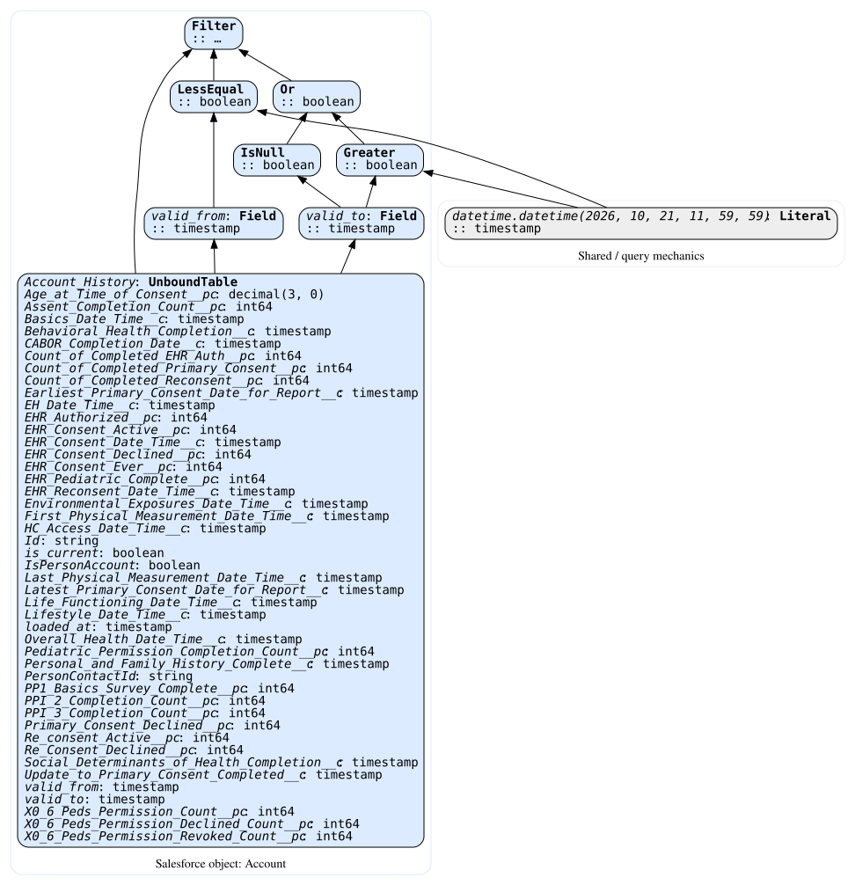

[SVG](account_to_survey_results_flow_Account_Before.svg) | [DOT](account_to_survey_results_flow_Account_Before.dot)

## Contact_At_Execution

Builder: `snapshot()`

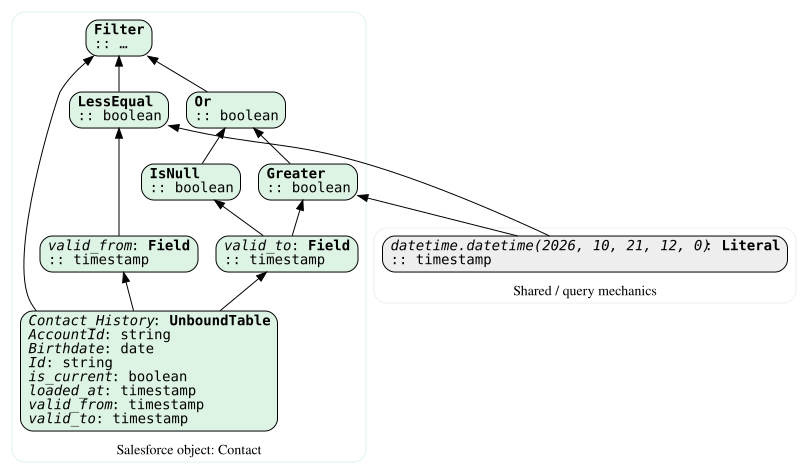

[SVG](account_to_survey_results_flow_Contact_At_Execution.svg) | [DOT](account_to_survey_results_flow_Contact_At_Execution.dot)

## Survey_Results_At_Execution

Builder: `snapshot()`

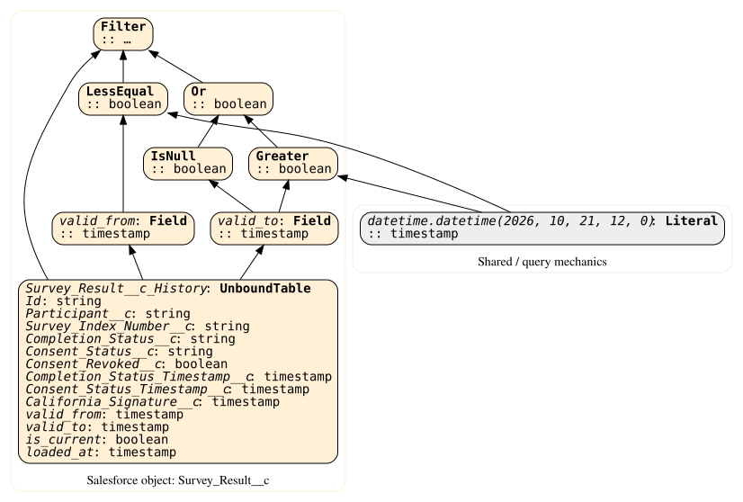

[SVG](account_to_survey_results_flow_Survey_Results_At_Execution.svg) | [DOT](account_to_survey_results_flow_Survey_Results_At_Execution.dot)

## Trigger_Survey_Result

Builder: `flow_account_query()`

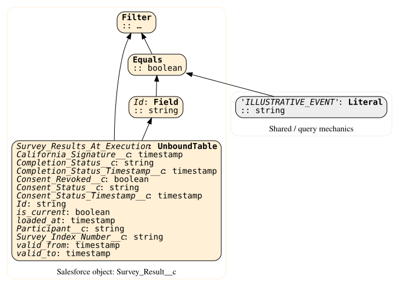

[SVG](account_to_survey_results_flow_Trigger_Survey_Result.svg) | [DOT](account_to_survey_results_flow_Trigger_Survey_Result.dot)

## Joined_Record

Builder: `join_account()`

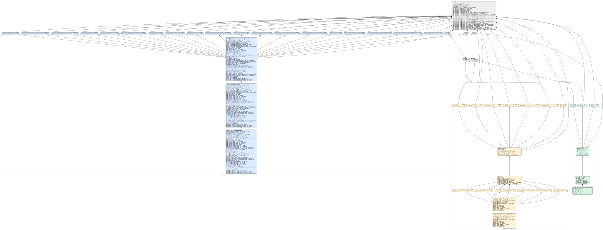

[SVG](account_to_survey_results_flow_Joined_Record.svg) | [DOT](account_to_survey_results_flow_Joined_Record.dot)

## Record_With_Primary_Consent

Builder: `FlowRecordLookup_Earliest_Other_Yes_Primary_Consent()`

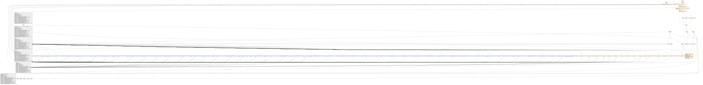

[SVG](account_to_survey_results_flow_Record_With_Primary_Consent.svg) | [DOT](account_to_survey_results_flow_Record_With_Primary_Consent.dot)

## Record_With_EHR_Consent

Builder: `FlowRecordLookup_Earliest_Other_Yes_EHR_Consent()`

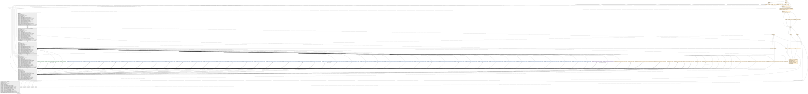

[SVG](account_to_survey_results_flow_Record_With_EHR_Consent.svg) | [DOT](account_to_survey_results_flow_Record_With_EHR_Consent.dot)

## Record_With_Physical_Measurement

Builder: `FlowRecordLookup_First_Remote_Physical_Measurement()`

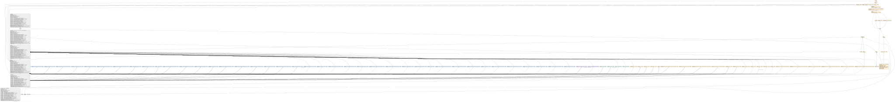

[SVG](account_to_survey_results_flow_Record_With_Physical_Measurement.svg) | [DOT](account_to_survey_results_flow_Record_With_Physical_Measurement.dot)

## Record_With_Pediatric_Permission

Builder: `FlowRecordLookup_Pediatric_Permission_For_Assent()`

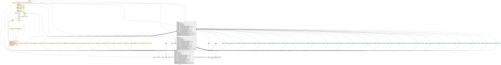

[SVG](account_to_survey_results_flow_Record_With_Pediatric_Permission.svg) | [DOT](account_to_survey_results_flow_Record_With_Pediatric_Permission.dot)

## Flow_Context

Builder: `add_flow_context()`

[SVG](account_to_survey_results_flow_Flow_Context.svg) | [DOT](account_to_survey_results_flow_Flow_Context.dot)

## Expected_Account

Builder: `expected_account_values()`

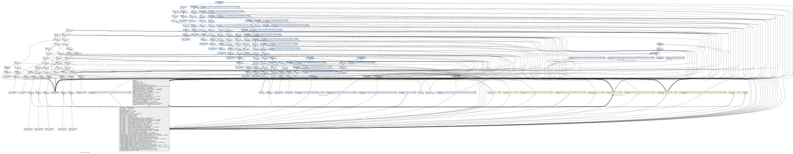

[SVG](account_to_survey_results_flow_Expected_Account.svg) | [DOT](account_to_survey_results_flow_Expected_Account.dot)

## Account_After

Builder: `snapshot()`

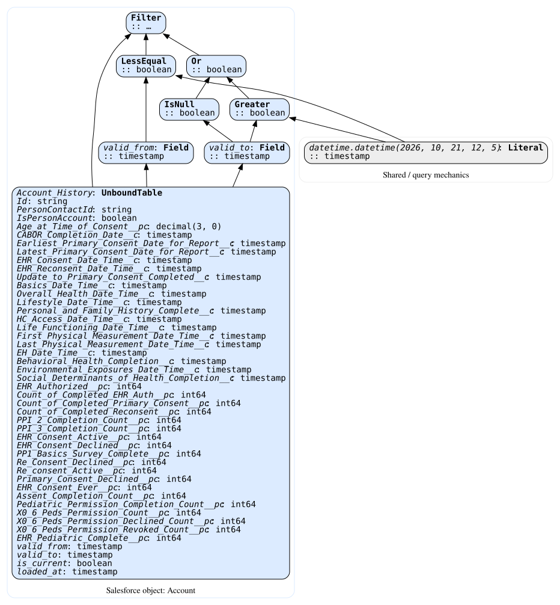

[SVG](account_to_survey_results_flow_Account_After.svg) | [DOT](account_to_survey_results_flow_Account_After.dot)

## Account_After_By_Survey_Event

Builder: `flow_account_query()`

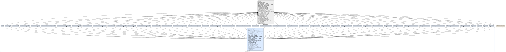

[SVG](account_to_survey_results_flow_Account_After_By_Survey_Event.svg) | [DOT](account_to_survey_results_flow_Account_After_By_Survey_Event.dot)

## Flow_Comparison

Builder: `flow_account_comparison()`

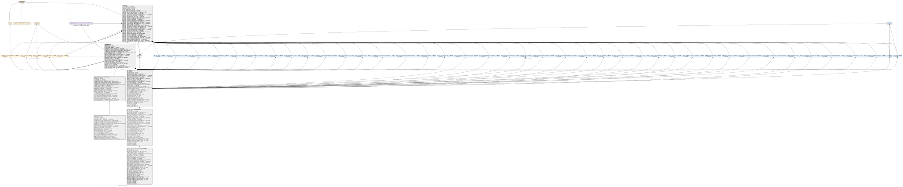

[SVG](account_to_survey_results_flow_Flow_Comparison.svg) | [DOT](account_to_survey_results_flow_Flow_Comparison.dot)
