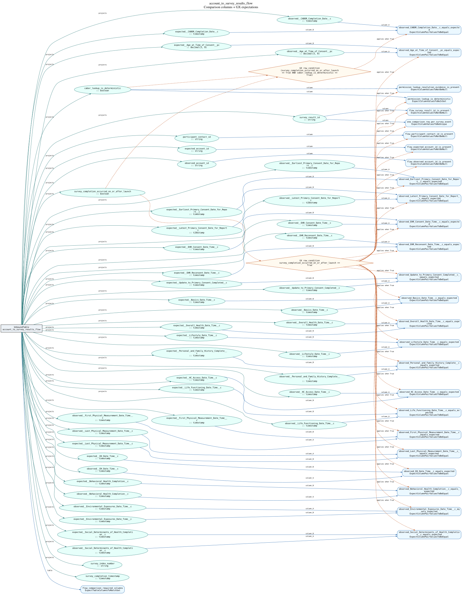

# account_to_survey_results_flow

Generated by `scripts/generate_suite_diagrams.py` from the authored Ibis comparison and native GX suite builder. Bindings/events are illustrative; no data was queried.

27 expectations; 46 comparison columns.

The compact view reads left to right: the Ibis comparison schema feeds green output columns; blue edges attach GX expectations to their target columns. Dashed orange edges show the independent row condition and its input columns. Table/schema checks attach to the comparison relation. These are validation bindings, not additional Ibis filters.



[Open binding SVG for zooming](account_to_survey_results_flow.svg) · [Binding DOT source](account_to_survey_results_flow.dot)

[Full native Ibis graph with expectations](account_to_survey_results_flow_ibis.svg) · [Full native DOT source](account_to_survey_results_flow_ibis.dot)

The full graph includes every Ibis operation, source table, join, formula and literal (including the launch cutoff). It reads bottom to top and retains individual column edges for schema assertions. Open its SVG to zoom into lineage.

## Expectations

| # | Check ID | Expectation | Target columns | Row condition |
| --- | --- | --- | --- | --- |
| 1 | flow_comparison_required_columns | ExpectTableColumnsToMatchSet | Schema: 45 required columns (listed below) | All rows (no row condition) |
| 2 | flow_survey_result_id_is_present | ExpectColumnValuesToNotBeNull | column: survey_result_id | survey_completion_occurred_on_or_after_launch == True |
| 3 | flow_participant_contact_id_is_present | ExpectColumnValuesToNotBeNull | column: participant_contact_id | survey_completion_occurred_on_or_after_launch == True |
| 4 | flow_expected_account_id_is_present | ExpectColumnValuesToNotBeNull | column: expected_account_id | survey_completion_occurred_on_or_after_launch == True |
| 5 | flow_observed_account_id_is_present | ExpectColumnValuesToNotBeNull | column: observed_account_id | survey_completion_occurred_on_or_after_launch == True |
| 6 | one_comparison_row_per_survey_event | ExpectColumnValuesToBeUnique | column: survey_result_id | survey_completion_occurred_on_or_after_launch == True |
| 7 | permission_lookup_resolution_evidence_is_present | ExpectColumnValuesToNotBeNull | column: cabor_lookup_is_deterministic | survey_completion_occurred_on_or_after_launch == True |
| 8 | permission_lookup_is_deterministic | ExpectColumnValuesToBeInSet | column: cabor_lookup_is_deterministic | survey_completion_occurred_on_or_after_launch == True |
| 9 | observed_Age_at_Time_of_Consent__pc_equals_expected | ExpectColumnPairValuesToBeEqual | column_A: observed__Age_at_Time_of_Consent__pc; column_B: expected__Age_at_Time_of_Consent__pc | survey_completion_occurred_on_or_after_launch == True |
| 10 | observed_CABOR_Completion_Date__c_equals_expected | ExpectColumnPairValuesToBeEqual | column_A: observed__CABOR_Completion_Date__c; column_B: expected__CABOR_Completion_Date__c | (survey_completion_occurred_on_or_after_launch == True AND cabor_lookup_is_deterministic == True) |
| 11 | observed_Earliest_Primary_Consent_Date_for_Report__c_equals_expected | ExpectColumnPairValuesToBeEqual | column_A: observed__Earliest_Primary_Consent_Date_for_Report__c; column_B: expected__Earliest_Primary_Consent_Date_for_Report__c | survey_completion_occurred_on_or_after_launch == True |
| 12 | observed_Latest_Primary_Consent_Date_for_Report__c_equals_expected | ExpectColumnPairValuesToBeEqual | column_A: observed__Latest_Primary_Consent_Date_for_Report__c; column_B: expected__Latest_Primary_Consent_Date_for_Report__c | survey_completion_occurred_on_or_after_launch == True |
| 13 | observed_EHR_Consent_Date_Time__c_equals_expected | ExpectColumnPairValuesToBeEqual | column_A: observed__EHR_Consent_Date_Time__c; column_B: expected__EHR_Consent_Date_Time__c | survey_completion_occurred_on_or_after_launch == True |
| 14 | observed_EHR_Reconsent_Date_Time__c_equals_expected | ExpectColumnPairValuesToBeEqual | column_A: observed__EHR_Reconsent_Date_Time__c; column_B: expected__EHR_Reconsent_Date_Time__c | survey_completion_occurred_on_or_after_launch == True |
| 15 | observed_Update_to_Primary_Consent_Completed__c_equals_expected | ExpectColumnPairValuesToBeEqual | column_A: observed__Update_to_Primary_Consent_Completed__c; column_B: expected__Update_to_Primary_Consent_Completed__c | survey_completion_occurred_on_or_after_launch == True |
| 16 | observed_Basics_Date_Time__c_equals_expected | ExpectColumnPairValuesToBeEqual | column_A: observed__Basics_Date_Time__c; column_B: expected__Basics_Date_Time__c | survey_completion_occurred_on_or_after_launch == True |
| 17 | observed_Overall_Health_Date_Time__c_equals_expected | ExpectColumnPairValuesToBeEqual | column_A: observed__Overall_Health_Date_Time__c; column_B: expected__Overall_Health_Date_Time__c | survey_completion_occurred_on_or_after_launch == True |
| 18 | observed_Lifestyle_Date_Time__c_equals_expected | ExpectColumnPairValuesToBeEqual | column_A: observed__Lifestyle_Date_Time__c; column_B: expected__Lifestyle_Date_Time__c | survey_completion_occurred_on_or_after_launch == True |
| 19 | observed_Personal_and_Family_History_Complete__c_equals_expected | ExpectColumnPairValuesToBeEqual | column_A: observed__Personal_and_Family_History_Complete__c; column_B: expected__Personal_and_Family_History_Complete__c | survey_completion_occurred_on_or_after_launch == True |
| 20 | observed_HC_Access_Date_Time__c_equals_expected | ExpectColumnPairValuesToBeEqual | column_A: observed__HC_Access_Date_Time__c; column_B: expected__HC_Access_Date_Time__c | survey_completion_occurred_on_or_after_launch == True |
| 21 | observed_Life_Functioning_Date_Time__c_equals_expected | ExpectColumnPairValuesToBeEqual | column_A: observed__Life_Functioning_Date_Time__c; column_B: expected__Life_Functioning_Date_Time__c | survey_completion_occurred_on_or_after_launch == True |
| 22 | observed_First_Physical_Measurement_Date_Time__c_equals_expected | ExpectColumnPairValuesToBeEqual | column_A: observed__First_Physical_Measurement_Date_Time__c; column_B: expected__First_Physical_Measurement_Date_Time__c | survey_completion_occurred_on_or_after_launch == True |
| 23 | observed_Last_Physical_Measurement_Date_Time__c_equals_expected | ExpectColumnPairValuesToBeEqual | column_A: observed__Last_Physical_Measurement_Date_Time__c; column_B: expected__Last_Physical_Measurement_Date_Time__c | survey_completion_occurred_on_or_after_launch == True |
| 24 | observed_EH_Date_Time__c_equals_expected | ExpectColumnPairValuesToBeEqual | column_A: observed__EH_Date_Time__c; column_B: expected__EH_Date_Time__c | survey_completion_occurred_on_or_after_launch == True |
| 25 | observed_Behavioral_Health_Completion__c_equals_expected | ExpectColumnPairValuesToBeEqual | column_A: observed__Behavioral_Health_Completion__c; column_B: expected__Behavioral_Health_Completion__c | survey_completion_occurred_on_or_after_launch == True |
| 26 | observed_Environmental_Exposures_Date_Time__c_equals_expected | ExpectColumnPairValuesToBeEqual | column_A: observed__Environmental_Exposures_Date_Time__c; column_B: expected__Environmental_Exposures_Date_Time__c | survey_completion_occurred_on_or_after_launch == True |
| 27 | observed_Social_Determinants_of_Health_Completion__c_equals_expected | ExpectColumnPairValuesToBeEqual | column_A: observed__Social_Determinants_of_Health_Completion__c; column_B: expected__Social_Determinants_of_Health_Completion__c | survey_completion_occurred_on_or_after_launch == True |

## Schema expectations

### flow_comparison_required_columns

```json
{
  "column_set": [
    "survey_result_id",
    "participant_contact_id",
    "expected_account_id",
    "observed_account_id",
    "cabor_lookup_is_deterministic",
    "survey_completion_timestamp",
    "survey_completion_occurred_on_or_after_launch",
    "expected__Age_at_Time_of_Consent__pc",
    "expected__CABOR_Completion_Date__c",
    "expected__Earliest_Primary_Consent_Date_for_Report__c",
    "expected__Latest_Primary_Consent_Date_for_Report__c",
    "expected__EHR_Consent_Date_Time__c",
    "expected__EHR_Reconsent_Date_Time__c",
    "expected__Update_to_Primary_Consent_Completed__c",
    "expected__Basics_Date_Time__c",
    "expected__Overall_Health_Date_Time__c",
    "expected__Lifestyle_Date_Time__c",
    "expected__Personal_and_Family_History_Complete__c",
    "expected__HC_Access_Date_Time__c",
    "expected__Life_Functioning_Date_Time__c",
    "expected__First_Physical_Measurement_Date_Time__c",
    "expected__Last_Physical_Measurement_Date_Time__c",
    "expected__EH_Date_Time__c",
    "expected__Behavioral_Health_Completion__c",
    "expected__Environmental_Exposures_Date_Time__c",
    "expected__Social_Determinants_of_Health_Completion__c",
    "observed__Age_at_Time_of_Consent__pc",
    "observed__CABOR_Completion_Date__c",
    "observed__Earliest_Primary_Consent_Date_for_Report__c",
    "observed__Latest_Primary_Consent_Date_for_Report__c",
    "observed__EHR_Consent_Date_Time__c",
    "observed__EHR_Reconsent_Date_Time__c",
    "observed__Update_to_Primary_Consent_Completed__c",
    "observed__Basics_Date_Time__c",
    "observed__Overall_Health_Date_Time__c",
    "observed__Lifestyle_Date_Time__c",
    "observed__Personal_and_Family_History_Complete__c",
    "observed__HC_Access_Date_Time__c",
    "observed__Life_Functioning_Date_Time__c",
    "observed__First_Physical_Measurement_Date_Time__c",
    "observed__Last_Physical_Measurement_Date_Time__c",
    "observed__EH_Date_Time__c",
    "observed__Behavioral_Health_Completion__c",
    "observed__Environmental_Exposures_Date_Time__c",
    "observed__Social_Determinants_of_Health_Completion__c"
  ],
  "exact_match": false
}
```


## Query and suite scope

```json
{
  "grain": "survey_event",
  "expected_state": "Account BEFORE plus one Flow event",
  "observed_state": "independent Account AFTER the same event",
  "row_scope": {
    "rule_id": "survey_completion_occurred_on_or_after_launch",
    "entity_type": "BusinessCondition",
    "comparison_role": "scope",
    "description": "Survey completion calendar date is on or after launch (2024-12-16)",
    "source_entities": [
      "Survey_Result__c.Completion_Status_Timestamp__c"
    ],
    "source_requirement": "User-specified post-launch scope for Account completion updates",
    "launch_date": "2024-12-16",
    "boundary": "inclusive",
    "timestamp_semantics": "Completion timestamp calendar date; normalize business timezone upstream",
    "null_policy": "Unknown completion timestamps retain NULL scope and are not Flow-validated"
  },
  "great_expectations_version": "1.24.0"
}
```

Python suite builders remain authoritative. This document describes authored expectations, not validation outcomes. Optional independent row-count checks appear only when included in the supplied suite.
