# account_to_survey_results_flow

Generated by `scripts/generate_suite_diagrams.py` from the comparison schema and native GX suite builders. Bindings/events are illustrative; no data was queried.

27 expectations; 46 comparison columns.

The overview groups fields by their exact GX row condition. Expand a field to see its columns, checks and configuration. Scope labels apply to every contained check; they do not filter the Ibis input. Green nodes are columns; blue nodes are expectations.


[Overview SVG](account_to_survey_results_flow.svg) · [Overview DOT](account_to_survey_results_flow.dot)

<details>
<summary>Schema and table checks (scope 1; expectations: 1)</summary>

Row condition: `All rows`

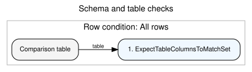

[Field SVG](account_to_survey_results_flow_00.svg) · [Field DOT](account_to_survey_results_flow_00.dot)

| # | Check ID | Expectation | Target columns | Row condition |
| --- | --- | --- | --- | --- |
| 1 | flow_comparison_required_columns | ExpectTableColumnsToMatchSet | Schema: 45 required columns (listed below) | All rows |

```json
{
  "column_set": [
    "survey_result_id",
    "participant_contact_id",
    "expected_account_id",
    "observed_account_id",
    "cabor_lookup_is_deterministic",
    "survey_completion_timestamp",
    "survey_completion_occurred_on_or_after_launch",
    "expected__Age_at_Time_of_Consent__pc",
    "expected__CABOR_Completion_Date__c",
    "expected__Earliest_Primary_Consent_Date_for_Report__c",
    "expected__Latest_Primary_Consent_Date_for_Report__c",
    "expected__EHR_Consent_Date_Time__c",
    "expected__EHR_Reconsent_Date_Time__c",
    "expected__Update_to_Primary_Consent_Completed__c",
    "expected__Basics_Date_Time__c",
    "expected__Overall_Health_Date_Time__c",
    "expected__Lifestyle_Date_Time__c",
    "expected__Personal_and_Family_History_Complete__c",
    "expected__HC_Access_Date_Time__c",
    "expected__Life_Functioning_Date_Time__c",
    "expected__First_Physical_Measurement_Date_Time__c",
    "expected__Last_Physical_Measurement_Date_Time__c",
    "expected__EH_Date_Time__c",
    "expected__Behavioral_Health_Completion__c",
    "expected__Environmental_Exposures_Date_Time__c",
    "expected__Social_Determinants_of_Health_Completion__c",
    "observed__Age_at_Time_of_Consent__pc",
    "observed__CABOR_Completion_Date__c",
    "observed__Earliest_Primary_Consent_Date_for_Report__c",
    "observed__Latest_Primary_Consent_Date_for_Report__c",
    "observed__EHR_Consent_Date_Time__c",
    "observed__EHR_Reconsent_Date_Time__c",
    "observed__Update_to_Primary_Consent_Completed__c",
    "observed__Basics_Date_Time__c",
    "observed__Overall_Health_Date_Time__c",
    "observed__Lifestyle_Date_Time__c",
    "observed__Personal_and_Family_History_Complete__c",
    "observed__HC_Access_Date_Time__c",
    "observed__Life_Functioning_Date_Time__c",
    "observed__First_Physical_Measurement_Date_Time__c",
    "observed__Last_Physical_Measurement_Date_Time__c",
    "observed__EH_Date_Time__c",
    "observed__Behavioral_Health_Completion__c",
    "observed__Environmental_Exposures_Date_Time__c",
    "observed__Social_Determinants_of_Health_Completion__c"
  ],
  "exact_match": false
}
```

</details>

<details>
<summary>Identity checks (scope 2; expectations: 5)</summary>

Row condition: `survey_completion_occurred_on_or_after_launch == True`

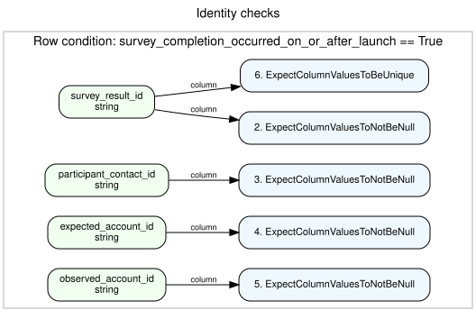

[Field SVG](account_to_survey_results_flow_01.svg) · [Field DOT](account_to_survey_results_flow_01.dot)

| # | Check ID | Expectation | Target columns | Row condition |
| --- | --- | --- | --- | --- |
| 2 | flow_survey_result_id_is_present | ExpectColumnValuesToNotBeNull | column: survey_result_id | survey_completion_occurred_on_or_after_launch == True |
| 3 | flow_participant_contact_id_is_present | ExpectColumnValuesToNotBeNull | column: participant_contact_id | survey_completion_occurred_on_or_after_launch == True |
| 4 | flow_expected_account_id_is_present | ExpectColumnValuesToNotBeNull | column: expected_account_id | survey_completion_occurred_on_or_after_launch == True |
| 5 | flow_observed_account_id_is_present | ExpectColumnValuesToNotBeNull | column: observed_account_id | survey_completion_occurred_on_or_after_launch == True |
| 6 | one_comparison_row_per_survey_event | ExpectColumnValuesToBeUnique | column: survey_result_id | survey_completion_occurred_on_or_after_launch == True |

</details>

<details>
<summary>Column: cabor_lookup_is_deterministic (scope 2; expectations: 2)</summary>

Row condition: `survey_completion_occurred_on_or_after_launch == True`

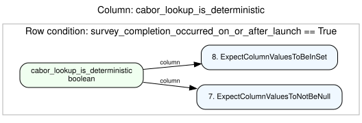

[Field SVG](account_to_survey_results_flow_02.svg) · [Field DOT](account_to_survey_results_flow_02.dot)

| # | Check ID | Expectation | Target columns | Row condition |
| --- | --- | --- | --- | --- |
| 7 | permission_lookup_resolution_evidence_is_present | ExpectColumnValuesToNotBeNull | column: cabor_lookup_is_deterministic | survey_completion_occurred_on_or_after_launch == True |
| 8 | permission_lookup_is_deterministic | ExpectColumnValuesToBeInSet | column: cabor_lookup_is_deterministic | survey_completion_occurred_on_or_after_launch == True |

</details>

<details>
<summary>Field: Age_at_Time_of_Consent__pc (scope 2; expectations: 1)</summary>

Row condition: `survey_completion_occurred_on_or_after_launch == True`

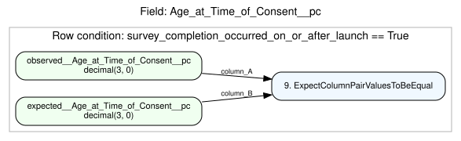

[Field SVG](account_to_survey_results_flow_03.svg) · [Field DOT](account_to_survey_results_flow_03.dot)

| # | Check ID | Expectation | Target columns | Row condition |
| --- | --- | --- | --- | --- |
| 9 | observed_Age_at_Time_of_Consent__pc_equals_expected | ExpectColumnPairValuesToBeEqual | column_A: observed__Age_at_Time_of_Consent__pc; column_B: expected__Age_at_Time_of_Consent__pc | survey_completion_occurred_on_or_after_launch == True |

</details>

<details>
<summary>Field: CABOR_Completion_Date__c (scope 3; expectations: 1)</summary>

Row condition: `(survey_completion_occurred_on_or_after_launch == True AND cabor_lookup_is_deterministic == True)`

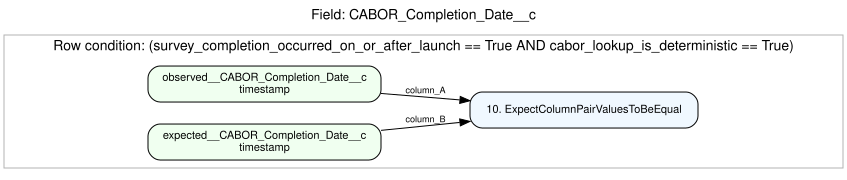

[Field SVG](account_to_survey_results_flow_04.svg) · [Field DOT](account_to_survey_results_flow_04.dot)

| # | Check ID | Expectation | Target columns | Row condition |
| --- | --- | --- | --- | --- |
| 10 | observed_CABOR_Completion_Date__c_equals_expected | ExpectColumnPairValuesToBeEqual | column_A: observed__CABOR_Completion_Date__c; column_B: expected__CABOR_Completion_Date__c | (survey_completion_occurred_on_or_after_launch == True AND cabor_lookup_is_deterministic == True) |

</details>

<details>
<summary>Field: Earliest_Primary_Consent_Date_for_Report__c (scope 2; expectations: 1)</summary>

Row condition: `survey_completion_occurred_on_or_after_launch == True`


[Field SVG](account_to_survey_results_flow_05.svg) · [Field DOT](account_to_survey_results_flow_05.dot)

| # | Check ID | Expectation | Target columns | Row condition |
| --- | --- | --- | --- | --- |
| 11 | observed_Earliest_Primary_Consent_Date_for_Report__c_equals_expected | ExpectColumnPairValuesToBeEqual | column_A: observed__Earliest_Primary_Consent_Date_for_Report__c; column_B: expected__Earliest_Primary_Consent_Date_for_Report__c | survey_completion_occurred_on_or_after_launch == True |

</details>

<details>
<summary>Field: Latest_Primary_Consent_Date_for_Report__c (scope 2; expectations: 1)</summary>

Row condition: `survey_completion_occurred_on_or_after_launch == True`


[Field SVG](account_to_survey_results_flow_06.svg) · [Field DOT](account_to_survey_results_flow_06.dot)

| # | Check ID | Expectation | Target columns | Row condition |
| --- | --- | --- | --- | --- |
| 12 | observed_Latest_Primary_Consent_Date_for_Report__c_equals_expected | ExpectColumnPairValuesToBeEqual | column_A: observed__Latest_Primary_Consent_Date_for_Report__c; column_B: expected__Latest_Primary_Consent_Date_for_Report__c | survey_completion_occurred_on_or_after_launch == True |

</details>

<details>
<summary>Field: EHR_Consent_Date_Time__c (scope 2; expectations: 1)</summary>

Row condition: `survey_completion_occurred_on_or_after_launch == True`

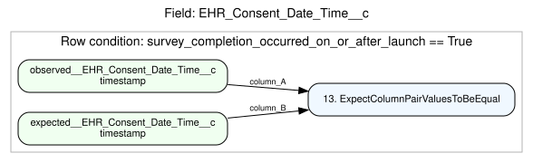

[Field SVG](account_to_survey_results_flow_07.svg) · [Field DOT](account_to_survey_results_flow_07.dot)

| # | Check ID | Expectation | Target columns | Row condition |
| --- | --- | --- | --- | --- |
| 13 | observed_EHR_Consent_Date_Time__c_equals_expected | ExpectColumnPairValuesToBeEqual | column_A: observed__EHR_Consent_Date_Time__c; column_B: expected__EHR_Consent_Date_Time__c | survey_completion_occurred_on_or_after_launch == True |

</details>

<details>
<summary>Field: EHR_Reconsent_Date_Time__c (scope 2; expectations: 1)</summary>

Row condition: `survey_completion_occurred_on_or_after_launch == True`


[Field SVG](account_to_survey_results_flow_08.svg) · [Field DOT](account_to_survey_results_flow_08.dot)

| # | Check ID | Expectation | Target columns | Row condition |
| --- | --- | --- | --- | --- |
| 14 | observed_EHR_Reconsent_Date_Time__c_equals_expected | ExpectColumnPairValuesToBeEqual | column_A: observed__EHR_Reconsent_Date_Time__c; column_B: expected__EHR_Reconsent_Date_Time__c | survey_completion_occurred_on_or_after_launch == True |

</details>

<details>
<summary>Field: Update_to_Primary_Consent_Completed__c (scope 2; expectations: 1)</summary>

Row condition: `survey_completion_occurred_on_or_after_launch == True`

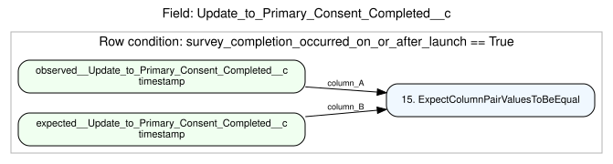

[Field SVG](account_to_survey_results_flow_09.svg) · [Field DOT](account_to_survey_results_flow_09.dot)

| # | Check ID | Expectation | Target columns | Row condition |
| --- | --- | --- | --- | --- |
| 15 | observed_Update_to_Primary_Consent_Completed__c_equals_expected | ExpectColumnPairValuesToBeEqual | column_A: observed__Update_to_Primary_Consent_Completed__c; column_B: expected__Update_to_Primary_Consent_Completed__c | survey_completion_occurred_on_or_after_launch == True |

</details>

<details>
<summary>Field: Basics_Date_Time__c (scope 2; expectations: 1)</summary>

Row condition: `survey_completion_occurred_on_or_after_launch == True`

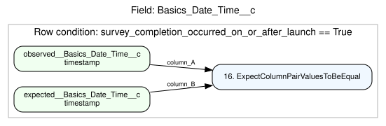

[Field SVG](account_to_survey_results_flow_10.svg) · [Field DOT](account_to_survey_results_flow_10.dot)

| # | Check ID | Expectation | Target columns | Row condition |
| --- | --- | --- | --- | --- |
| 16 | observed_Basics_Date_Time__c_equals_expected | ExpectColumnPairValuesToBeEqual | column_A: observed__Basics_Date_Time__c; column_B: expected__Basics_Date_Time__c | survey_completion_occurred_on_or_after_launch == True |

</details>

<details>
<summary>Field: Overall_Health_Date_Time__c (scope 2; expectations: 1)</summary>

Row condition: `survey_completion_occurred_on_or_after_launch == True`


[Field SVG](account_to_survey_results_flow_11.svg) · [Field DOT](account_to_survey_results_flow_11.dot)

| # | Check ID | Expectation | Target columns | Row condition |
| --- | --- | --- | --- | --- |
| 17 | observed_Overall_Health_Date_Time__c_equals_expected | ExpectColumnPairValuesToBeEqual | column_A: observed__Overall_Health_Date_Time__c; column_B: expected__Overall_Health_Date_Time__c | survey_completion_occurred_on_or_after_launch == True |

</details>

<details>
<summary>Field: Lifestyle_Date_Time__c (scope 2; expectations: 1)</summary>

Row condition: `survey_completion_occurred_on_or_after_launch == True`

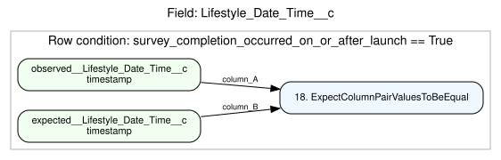

[Field SVG](account_to_survey_results_flow_12.svg) · [Field DOT](account_to_survey_results_flow_12.dot)

| # | Check ID | Expectation | Target columns | Row condition |
| --- | --- | --- | --- | --- |
| 18 | observed_Lifestyle_Date_Time__c_equals_expected | ExpectColumnPairValuesToBeEqual | column_A: observed__Lifestyle_Date_Time__c; column_B: expected__Lifestyle_Date_Time__c | survey_completion_occurred_on_or_after_launch == True |

</details>

<details>
<summary>Field: Personal_and_Family_History_Complete__c (scope 2; expectations: 1)</summary>

Row condition: `survey_completion_occurred_on_or_after_launch == True`

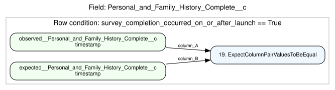

[Field SVG](account_to_survey_results_flow_13.svg) · [Field DOT](account_to_survey_results_flow_13.dot)

| # | Check ID | Expectation | Target columns | Row condition |
| --- | --- | --- | --- | --- |
| 19 | observed_Personal_and_Family_History_Complete__c_equals_expected | ExpectColumnPairValuesToBeEqual | column_A: observed__Personal_and_Family_History_Complete__c; column_B: expected__Personal_and_Family_History_Complete__c | survey_completion_occurred_on_or_after_launch == True |

</details>

<details>
<summary>Field: HC_Access_Date_Time__c (scope 2; expectations: 1)</summary>

Row condition: `survey_completion_occurred_on_or_after_launch == True`

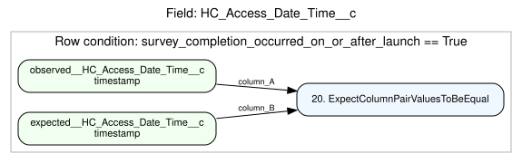

[Field SVG](account_to_survey_results_flow_14.svg) · [Field DOT](account_to_survey_results_flow_14.dot)

| # | Check ID | Expectation | Target columns | Row condition |
| --- | --- | --- | --- | --- |
| 20 | observed_HC_Access_Date_Time__c_equals_expected | ExpectColumnPairValuesToBeEqual | column_A: observed__HC_Access_Date_Time__c; column_B: expected__HC_Access_Date_Time__c | survey_completion_occurred_on_or_after_launch == True |

</details>

<details>
<summary>Field: Life_Functioning_Date_Time__c (scope 2; expectations: 1)</summary>

Row condition: `survey_completion_occurred_on_or_after_launch == True`

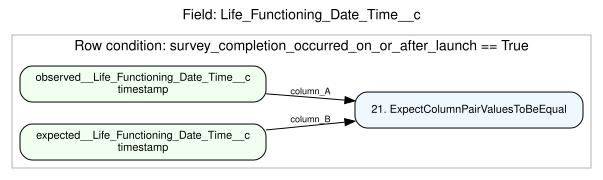

[Field SVG](account_to_survey_results_flow_15.svg) · [Field DOT](account_to_survey_results_flow_15.dot)

| # | Check ID | Expectation | Target columns | Row condition |
| --- | --- | --- | --- | --- |
| 21 | observed_Life_Functioning_Date_Time__c_equals_expected | ExpectColumnPairValuesToBeEqual | column_A: observed__Life_Functioning_Date_Time__c; column_B: expected__Life_Functioning_Date_Time__c | survey_completion_occurred_on_or_after_launch == True |

</details>

<details>
<summary>Field: First_Physical_Measurement_Date_Time__c (scope 2; expectations: 1)</summary>

Row condition: `survey_completion_occurred_on_or_after_launch == True`


[Field SVG](account_to_survey_results_flow_16.svg) · [Field DOT](account_to_survey_results_flow_16.dot)

| # | Check ID | Expectation | Target columns | Row condition |
| --- | --- | --- | --- | --- |
| 22 | observed_First_Physical_Measurement_Date_Time__c_equals_expected | ExpectColumnPairValuesToBeEqual | column_A: observed__First_Physical_Measurement_Date_Time__c; column_B: expected__First_Physical_Measurement_Date_Time__c | survey_completion_occurred_on_or_after_launch == True |

</details>

<details>
<summary>Field: Last_Physical_Measurement_Date_Time__c (scope 2; expectations: 1)</summary>

Row condition: `survey_completion_occurred_on_or_after_launch == True`


[Field SVG](account_to_survey_results_flow_17.svg) · [Field DOT](account_to_survey_results_flow_17.dot)

| # | Check ID | Expectation | Target columns | Row condition |
| --- | --- | --- | --- | --- |
| 23 | observed_Last_Physical_Measurement_Date_Time__c_equals_expected | ExpectColumnPairValuesToBeEqual | column_A: observed__Last_Physical_Measurement_Date_Time__c; column_B: expected__Last_Physical_Measurement_Date_Time__c | survey_completion_occurred_on_or_after_launch == True |

</details>

<details>
<summary>Field: EH_Date_Time__c (scope 2; expectations: 1)</summary>

Row condition: `survey_completion_occurred_on_or_after_launch == True`

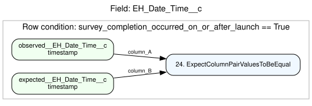

[Field SVG](account_to_survey_results_flow_18.svg) · [Field DOT](account_to_survey_results_flow_18.dot)

| # | Check ID | Expectation | Target columns | Row condition |
| --- | --- | --- | --- | --- |
| 24 | observed_EH_Date_Time__c_equals_expected | ExpectColumnPairValuesToBeEqual | column_A: observed__EH_Date_Time__c; column_B: expected__EH_Date_Time__c | survey_completion_occurred_on_or_after_launch == True |

</details>

<details>
<summary>Field: Behavioral_Health_Completion__c (scope 2; expectations: 1)</summary>

Row condition: `survey_completion_occurred_on_or_after_launch == True`


[Field SVG](account_to_survey_results_flow_19.svg) · [Field DOT](account_to_survey_results_flow_19.dot)

| # | Check ID | Expectation | Target columns | Row condition |
| --- | --- | --- | --- | --- |
| 25 | observed_Behavioral_Health_Completion__c_equals_expected | ExpectColumnPairValuesToBeEqual | column_A: observed__Behavioral_Health_Completion__c; column_B: expected__Behavioral_Health_Completion__c | survey_completion_occurred_on_or_after_launch == True |

</details>

<details>
<summary>Field: Environmental_Exposures_Date_Time__c (scope 2; expectations: 1)</summary>

Row condition: `survey_completion_occurred_on_or_after_launch == True`

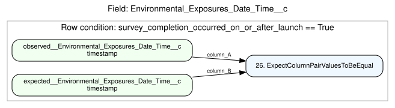

[Field SVG](account_to_survey_results_flow_20.svg) · [Field DOT](account_to_survey_results_flow_20.dot)

| # | Check ID | Expectation | Target columns | Row condition |
| --- | --- | --- | --- | --- |
| 26 | observed_Environmental_Exposures_Date_Time__c_equals_expected | ExpectColumnPairValuesToBeEqual | column_A: observed__Environmental_Exposures_Date_Time__c; column_B: expected__Environmental_Exposures_Date_Time__c | survey_completion_occurred_on_or_after_launch == True |

</details>

<details>
<summary>Field: Social_Determinants_of_Health_Completion__c (scope 2; expectations: 1)</summary>

Row condition: `survey_completion_occurred_on_or_after_launch == True`

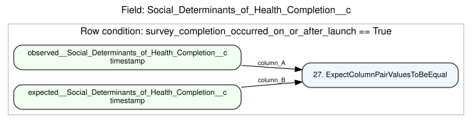

[Field SVG](account_to_survey_results_flow_21.svg) · [Field DOT](account_to_survey_results_flow_21.dot)

| # | Check ID | Expectation | Target columns | Row condition |
| --- | --- | --- | --- | --- |
| 27 | observed_Social_Determinants_of_Health_Completion__c_equals_expected | ExpectColumnPairValuesToBeEqual | column_A: observed__Social_Determinants_of_Health_Completion__c; column_B: expected__Social_Determinants_of_Health_Completion__c | survey_completion_occurred_on_or_after_launch == True |

</details>

## Suite metadata

```json
{
  "grain": "survey_event",
  "expected_state": "Account BEFORE plus one Flow event",
  "observed_state": "independent Account AFTER the same event",
  "row_scope": {
    "rule_id": "survey_completion_occurred_on_or_after_launch",
    "entity_type": "BusinessCondition",
    "comparison_role": "scope",
    "description": "Survey completion calendar date is on or after launch (2024-12-16)",
    "source_entities": [
      "Survey_Result__c.Completion_Status_Timestamp__c"
    ],
    "source_requirement": "User-specified post-launch scope for Account completion updates",
    "launch_date": "2024-12-16",
    "boundary": "inclusive",
    "timestamp_semantics": "Completion timestamp calendar date; normalize business timezone upstream",
    "null_policy": "Unknown completion timestamps retain NULL scope and are not Flow-validated"
  },
  "great_expectations_version": "1.24.0"
}
```

Python suite builders remain authoritative. These are authored expectations, not validation outcomes. Optional row-count checks appear only when supplied.
