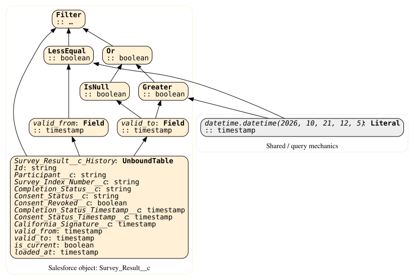
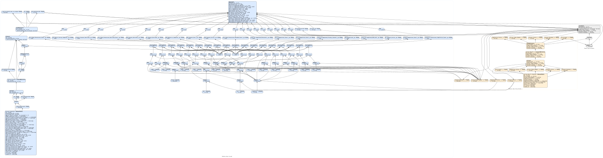
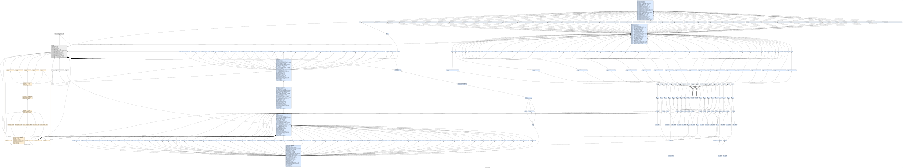

# account_to_survey_results_rollups

Native Ibis table graphs, split at function and intermediate-table boundaries. Each named input has the exact schema of its preceding stage, but no upstream expression graph. These are diagram-only boundaries, not materialized runtime tables.

Bindings and events are illustrative; no data was queried. Graphs retain Ibis's native nodes, edges and labels, with parent-entity colors and clusters; there are no GX overlays.

Fields are grouped by their Salesforce object, including expected and observed fields. Flow elements are grouped by their owning Flow from the authoritative lineage. Field ownership is preserved across diagram boundaries. Shared expressions, mixed-object relations and unmapped query mechanics are neutral gray.

| Parent entity | Fill color |
| --- | --- |
| Salesforce object: Account | `#DCEBFF` |
| Salesforce object: Contact | `#DDF4E4` |
| Salesforce object: Survey_Result__c | `#FFF0D6` |
| Flow: Survey_Result_Survey_Completion_Updates | `#EADFFA` |
| Shared / query mechanics | `#EEEEEE` |

| Output / diagram | Builder | Inputs |
| --- | --- | --- |
| [Account_Snapshot](account_to_survey_results_rollups_Account_Snapshot.svg) | `snapshot()` | `Account_History` |
| [Survey_Result_Snapshot](account_to_survey_results_rollups_Survey_Result_Snapshot.svg) | `snapshot()` | `Survey_Result__c_History` |
| [Expected_Rollups](account_to_survey_results_rollups_Expected_Rollups.svg) | `expected_survey_rollups()` | `Account_Snapshot`, `Survey_Result_Snapshot` |
| [Rollup_Comparison](account_to_survey_results_rollups_Rollup_Comparison.svg) | `rollup_account_comparison()` | `Account_Snapshot`, `Survey_Result_Snapshot` |

## Account_Snapshot

Builder: `snapshot()`

[SVG](account_to_survey_results_rollups_Account_Snapshot.svg) | [DOT](account_to_survey_results_rollups_Account_Snapshot.dot)

## Survey_Result_Snapshot

Builder: `snapshot()`

[SVG](account_to_survey_results_rollups_Survey_Result_Snapshot.svg) | [DOT](account_to_survey_results_rollups_Survey_Result_Snapshot.dot)

## Expected_Rollups

Builder: `expected_survey_rollups()`

[SVG](account_to_survey_results_rollups_Expected_Rollups.svg) | [DOT](account_to_survey_results_rollups_Expected_Rollups.dot)

## Rollup_Comparison

Builder: `rollup_account_comparison()`

[SVG](account_to_survey_results_rollups_Rollup_Comparison.svg) | [DOT](account_to_survey_results_rollups_Rollup_Comparison.dot)
