# account_to_survey_results_rollups

Generated by `scripts/generate_suite_diagrams.py` from the comparison schema and native GX suite builders. Bindings/events are illustrative; no data was queried.

24 expectations; 41 comparison columns.

The overview groups fields by their exact GX row condition. Expand a field to see its columns, checks and configuration. Scope labels apply to every contained check; they do not filter the Ibis input. Green nodes are columns; blue nodes are expectations.


[Overview SVG](account_to_survey_results_rollups.svg) · [Overview DOT](account_to_survey_results_rollups.dot)

<details>
<summary>Schema and table checks (scope 1; expectations: 1)</summary>

Row condition: `All rows`

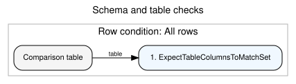

[Field SVG](account_to_survey_results_rollups_00.svg) · [Field DOT](account_to_survey_results_rollups_00.dot)

| # | Check ID | Expectation | Target columns | Row condition |
| --- | --- | --- | --- | --- |
| 1 | rollup_comparison_required_columns | ExpectTableColumnsToMatchSet | Schema: 41 required columns (listed below) | All rows |

```json
{
  "column_set": [
    "expected_account_id",
    "person_contact_id",
    "observed_account_id",
    "expected__EHR_Authorized__pc",
    "expected__Count_of_Completed_EHR_Auth__pc",
    "expected__Count_of_Completed_Primary_Consent__pc",
    "expected__Count_of_Completed_Reconsent__pc",
    "expected__PPI_2_Completion_Count__pc",
    "expected__PPI_3_Completion_Count__pc",
    "expected__EHR_Consent_Active__pc",
    "expected__EHR_Consent_Declined__pc",
    "expected__PP1_Basics_Survey_Complete__pc",
    "expected__Re_Consent_Declined__pc",
    "expected__Re_consent_Active__pc",
    "expected__Primary_Consent_Declined__pc",
    "expected__EHR_Consent_Ever__pc",
    "expected__Assent_Completion_Count__pc",
    "expected__Pediatric_Permission_Completion_Count__pc",
    "expected__X0_6_Peds_Permission_Count__pc",
    "expected__X0_6_Peds_Permission_Declined_Count__pc",
    "expected__X0_6_Peds_Permission_Revoked_Count__pc",
    "expected__EHR_Pediatric_Complete__pc",
    "observed__EHR_Authorized__pc",
    "observed__Count_of_Completed_EHR_Auth__pc",
    "observed__Count_of_Completed_Primary_Consent__pc",
    "observed__Count_of_Completed_Reconsent__pc",
    "observed__PPI_2_Completion_Count__pc",
    "observed__PPI_3_Completion_Count__pc",
    "observed__EHR_Consent_Active__pc",
    "observed__EHR_Consent_Declined__pc",
    "observed__PP1_Basics_Survey_Complete__pc",
    "observed__Re_Consent_Declined__pc",
    "observed__Re_consent_Active__pc",
    "observed__Primary_Consent_Declined__pc",
    "observed__EHR_Consent_Ever__pc",
    "observed__Assent_Completion_Count__pc",
    "observed__Pediatric_Permission_Completion_Count__pc",
    "observed__X0_6_Peds_Permission_Count__pc",
    "observed__X0_6_Peds_Permission_Declined_Count__pc",
    "observed__X0_6_Peds_Permission_Revoked_Count__pc",
    "observed__EHR_Pediatric_Complete__pc"
  ],
  "exact_match": false
}
```

</details>

<details>
<summary>Identity checks (scope 1; expectations: 4)</summary>

Row condition: `All rows`

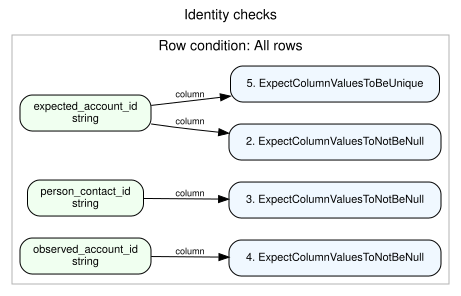

[Field SVG](account_to_survey_results_rollups_01.svg) · [Field DOT](account_to_survey_results_rollups_01.dot)

| # | Check ID | Expectation | Target columns | Row condition |
| --- | --- | --- | --- | --- |
| 2 | rollup_expected_account_id_is_present | ExpectColumnValuesToNotBeNull | column: expected_account_id | All rows |
| 3 | rollup_person_contact_id_is_present | ExpectColumnValuesToNotBeNull | column: person_contact_id | All rows |
| 4 | rollup_observed_account_id_is_present | ExpectColumnValuesToNotBeNull | column: observed_account_id | All rows |
| 5 | one_rollup_comparison_row_per_person_account | ExpectColumnValuesToBeUnique | column: expected_account_id | All rows |

</details>

<details>
<summary>Field: EHR_Authorized__pc (scope 1; expectations: 1)</summary>

Row condition: `All rows`

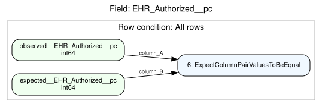

[Field SVG](account_to_survey_results_rollups_02.svg) · [Field DOT](account_to_survey_results_rollups_02.dot)

| # | Check ID | Expectation | Target columns | Row condition |
| --- | --- | --- | --- | --- |
| 6 | observed_EHR_Authorized__pc_equals_expected_rollup | ExpectColumnPairValuesToBeEqual | column_A: observed__EHR_Authorized__pc; column_B: expected__EHR_Authorized__pc | All rows |

</details>

<details>
<summary>Field: Count_of_Completed_EHR_Auth__pc (scope 1; expectations: 1)</summary>

Row condition: `All rows`

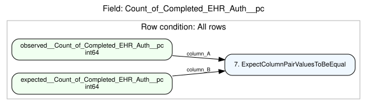

[Field SVG](account_to_survey_results_rollups_03.svg) · [Field DOT](account_to_survey_results_rollups_03.dot)

| # | Check ID | Expectation | Target columns | Row condition |
| --- | --- | --- | --- | --- |
| 7 | observed_Count_of_Completed_EHR_Auth__pc_equals_expected_rollup | ExpectColumnPairValuesToBeEqual | column_A: observed__Count_of_Completed_EHR_Auth__pc; column_B: expected__Count_of_Completed_EHR_Auth__pc | All rows |

</details>

<details>
<summary>Field: Count_of_Completed_Primary_Consent__pc (scope 1; expectations: 1)</summary>

Row condition: `All rows`

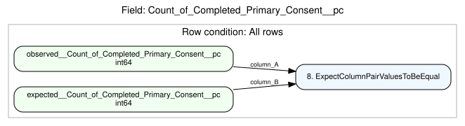

[Field SVG](account_to_survey_results_rollups_04.svg) · [Field DOT](account_to_survey_results_rollups_04.dot)

| # | Check ID | Expectation | Target columns | Row condition |
| --- | --- | --- | --- | --- |
| 8 | observed_Count_of_Completed_Primary_Consent__pc_equals_expected_rollup | ExpectColumnPairValuesToBeEqual | column_A: observed__Count_of_Completed_Primary_Consent__pc; column_B: expected__Count_of_Completed_Primary_Consent__pc | All rows |

</details>

<details>
<summary>Field: Count_of_Completed_Reconsent__pc (scope 1; expectations: 1)</summary>

Row condition: `All rows`

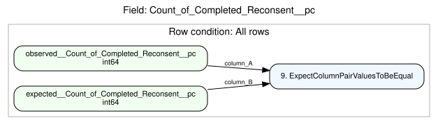

[Field SVG](account_to_survey_results_rollups_05.svg) · [Field DOT](account_to_survey_results_rollups_05.dot)

| # | Check ID | Expectation | Target columns | Row condition |
| --- | --- | --- | --- | --- |
| 9 | observed_Count_of_Completed_Reconsent__pc_equals_expected_rollup | ExpectColumnPairValuesToBeEqual | column_A: observed__Count_of_Completed_Reconsent__pc; column_B: expected__Count_of_Completed_Reconsent__pc | All rows |

</details>

<details>
<summary>Field: PPI_2_Completion_Count__pc (scope 1; expectations: 1)</summary>

Row condition: `All rows`


[Field SVG](account_to_survey_results_rollups_06.svg) · [Field DOT](account_to_survey_results_rollups_06.dot)

| # | Check ID | Expectation | Target columns | Row condition |
| --- | --- | --- | --- | --- |
| 10 | observed_PPI_2_Completion_Count__pc_equals_expected_rollup | ExpectColumnPairValuesToBeEqual | column_A: observed__PPI_2_Completion_Count__pc; column_B: expected__PPI_2_Completion_Count__pc | All rows |

</details>

<details>
<summary>Field: PPI_3_Completion_Count__pc (scope 1; expectations: 1)</summary>

Row condition: `All rows`


[Field SVG](account_to_survey_results_rollups_07.svg) · [Field DOT](account_to_survey_results_rollups_07.dot)

| # | Check ID | Expectation | Target columns | Row condition |
| --- | --- | --- | --- | --- |
| 11 | observed_PPI_3_Completion_Count__pc_equals_expected_rollup | ExpectColumnPairValuesToBeEqual | column_A: observed__PPI_3_Completion_Count__pc; column_B: expected__PPI_3_Completion_Count__pc | All rows |

</details>

<details>
<summary>Field: EHR_Consent_Active__pc (scope 1; expectations: 1)</summary>

Row condition: `All rows`

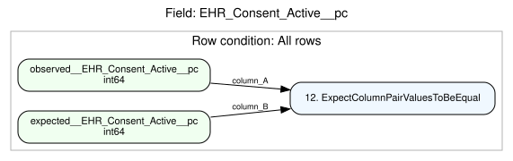

[Field SVG](account_to_survey_results_rollups_08.svg) · [Field DOT](account_to_survey_results_rollups_08.dot)

| # | Check ID | Expectation | Target columns | Row condition |
| --- | --- | --- | --- | --- |
| 12 | observed_EHR_Consent_Active__pc_equals_expected_rollup | ExpectColumnPairValuesToBeEqual | column_A: observed__EHR_Consent_Active__pc; column_B: expected__EHR_Consent_Active__pc | All rows |

</details>

<details>
<summary>Field: EHR_Consent_Declined__pc (scope 1; expectations: 1)</summary>

Row condition: `All rows`

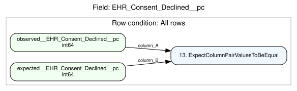

[Field SVG](account_to_survey_results_rollups_09.svg) · [Field DOT](account_to_survey_results_rollups_09.dot)

| # | Check ID | Expectation | Target columns | Row condition |
| --- | --- | --- | --- | --- |
| 13 | observed_EHR_Consent_Declined__pc_equals_expected_rollup | ExpectColumnPairValuesToBeEqual | column_A: observed__EHR_Consent_Declined__pc; column_B: expected__EHR_Consent_Declined__pc | All rows |

</details>

<details>
<summary>Field: PP1_Basics_Survey_Complete__pc (scope 1; expectations: 1)</summary>

Row condition: `All rows`

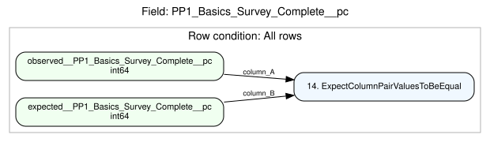

[Field SVG](account_to_survey_results_rollups_10.svg) · [Field DOT](account_to_survey_results_rollups_10.dot)

| # | Check ID | Expectation | Target columns | Row condition |
| --- | --- | --- | --- | --- |
| 14 | observed_PP1_Basics_Survey_Complete__pc_equals_expected_rollup | ExpectColumnPairValuesToBeEqual | column_A: observed__PP1_Basics_Survey_Complete__pc; column_B: expected__PP1_Basics_Survey_Complete__pc | All rows |

</details>

<details>
<summary>Field: Re_Consent_Declined__pc (scope 1; expectations: 1)</summary>

Row condition: `All rows`

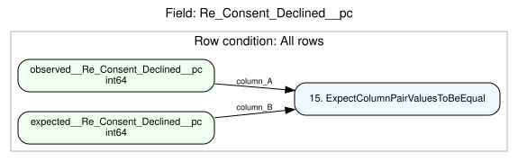

[Field SVG](account_to_survey_results_rollups_11.svg) · [Field DOT](account_to_survey_results_rollups_11.dot)

| # | Check ID | Expectation | Target columns | Row condition |
| --- | --- | --- | --- | --- |
| 15 | observed_Re_Consent_Declined__pc_equals_expected_rollup | ExpectColumnPairValuesToBeEqual | column_A: observed__Re_Consent_Declined__pc; column_B: expected__Re_Consent_Declined__pc | All rows |

</details>

<details>
<summary>Field: Re_consent_Active__pc (scope 1; expectations: 1)</summary>

Row condition: `All rows`


[Field SVG](account_to_survey_results_rollups_12.svg) · [Field DOT](account_to_survey_results_rollups_12.dot)

| # | Check ID | Expectation | Target columns | Row condition |
| --- | --- | --- | --- | --- |
| 16 | observed_Re_consent_Active__pc_equals_expected_rollup | ExpectColumnPairValuesToBeEqual | column_A: observed__Re_consent_Active__pc; column_B: expected__Re_consent_Active__pc | All rows |

</details>

<details>
<summary>Field: Primary_Consent_Declined__pc (scope 1; expectations: 1)</summary>

Row condition: `All rows`

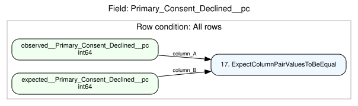

[Field SVG](account_to_survey_results_rollups_13.svg) · [Field DOT](account_to_survey_results_rollups_13.dot)

| # | Check ID | Expectation | Target columns | Row condition |
| --- | --- | --- | --- | --- |
| 17 | observed_Primary_Consent_Declined__pc_equals_expected_rollup | ExpectColumnPairValuesToBeEqual | column_A: observed__Primary_Consent_Declined__pc; column_B: expected__Primary_Consent_Declined__pc | All rows |

</details>

<details>
<summary>Field: EHR_Consent_Ever__pc (scope 1; expectations: 1)</summary>

Row condition: `All rows`

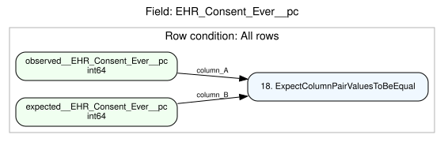

[Field SVG](account_to_survey_results_rollups_14.svg) · [Field DOT](account_to_survey_results_rollups_14.dot)

| # | Check ID | Expectation | Target columns | Row condition |
| --- | --- | --- | --- | --- |
| 18 | observed_EHR_Consent_Ever__pc_equals_expected_rollup | ExpectColumnPairValuesToBeEqual | column_A: observed__EHR_Consent_Ever__pc; column_B: expected__EHR_Consent_Ever__pc | All rows |

</details>

<details>
<summary>Field: Assent_Completion_Count__pc (scope 1; expectations: 1)</summary>

Row condition: `All rows`

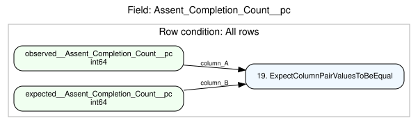

[Field SVG](account_to_survey_results_rollups_15.svg) · [Field DOT](account_to_survey_results_rollups_15.dot)

| # | Check ID | Expectation | Target columns | Row condition |
| --- | --- | --- | --- | --- |
| 19 | observed_Assent_Completion_Count__pc_equals_expected_rollup | ExpectColumnPairValuesToBeEqual | column_A: observed__Assent_Completion_Count__pc; column_B: expected__Assent_Completion_Count__pc | All rows |

</details>

<details>
<summary>Field: Pediatric_Permission_Completion_Count__pc (scope 1; expectations: 1)</summary>

Row condition: `All rows`

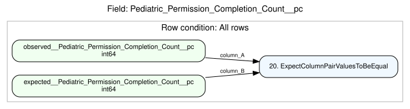

[Field SVG](account_to_survey_results_rollups_16.svg) · [Field DOT](account_to_survey_results_rollups_16.dot)

| # | Check ID | Expectation | Target columns | Row condition |
| --- | --- | --- | --- | --- |
| 20 | observed_Pediatric_Permission_Completion_Count__pc_equals_expected_rollup | ExpectColumnPairValuesToBeEqual | column_A: observed__Pediatric_Permission_Completion_Count__pc; column_B: expected__Pediatric_Permission_Completion_Count__pc | All rows |

</details>

<details>
<summary>Field: X0_6_Peds_Permission_Count__pc (scope 1; expectations: 1)</summary>

Row condition: `All rows`

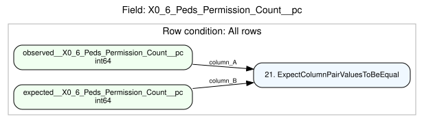

[Field SVG](account_to_survey_results_rollups_17.svg) · [Field DOT](account_to_survey_results_rollups_17.dot)

| # | Check ID | Expectation | Target columns | Row condition |
| --- | --- | --- | --- | --- |
| 21 | observed_X0_6_Peds_Permission_Count__pc_equals_expected_rollup | ExpectColumnPairValuesToBeEqual | column_A: observed__X0_6_Peds_Permission_Count__pc; column_B: expected__X0_6_Peds_Permission_Count__pc | All rows |

</details>

<details>
<summary>Field: X0_6_Peds_Permission_Declined_Count__pc (scope 1; expectations: 1)</summary>

Row condition: `All rows`


[Field SVG](account_to_survey_results_rollups_18.svg) · [Field DOT](account_to_survey_results_rollups_18.dot)

| # | Check ID | Expectation | Target columns | Row condition |
| --- | --- | --- | --- | --- |
| 22 | observed_X0_6_Peds_Permission_Declined_Count__pc_equals_expected_rollup | ExpectColumnPairValuesToBeEqual | column_A: observed__X0_6_Peds_Permission_Declined_Count__pc; column_B: expected__X0_6_Peds_Permission_Declined_Count__pc | All rows |

</details>

<details>
<summary>Field: X0_6_Peds_Permission_Revoked_Count__pc (scope 1; expectations: 1)</summary>

Row condition: `All rows`


[Field SVG](account_to_survey_results_rollups_19.svg) · [Field DOT](account_to_survey_results_rollups_19.dot)

| # | Check ID | Expectation | Target columns | Row condition |
| --- | --- | --- | --- | --- |
| 23 | observed_X0_6_Peds_Permission_Revoked_Count__pc_equals_expected_rollup | ExpectColumnPairValuesToBeEqual | column_A: observed__X0_6_Peds_Permission_Revoked_Count__pc; column_B: expected__X0_6_Peds_Permission_Revoked_Count__pc | All rows |

</details>

<details>
<summary>Field: EHR_Pediatric_Complete__pc (scope 1; expectations: 1)</summary>

Row condition: `All rows`


[Field SVG](account_to_survey_results_rollups_20.svg) · [Field DOT](account_to_survey_results_rollups_20.dot)

| # | Check ID | Expectation | Target columns | Row condition |
| --- | --- | --- | --- | --- |
| 24 | observed_EHR_Pediatric_Complete__pc_equals_expected_rollup | ExpectColumnPairValuesToBeEqual | column_A: observed__EHR_Pediatric_Complete__pc; column_B: expected__EHR_Pediatric_Complete__pc | All rows |

</details>

## Suite metadata

```json
{
  "grain": "person_account",
  "state": "same current snapshot for all inputs",
  "great_expectations_version": "1.24.0"
}
```

Python suite builders remain authoritative. These are authored expectations, not validation outcomes. Optional row-count checks appear only when supplied.
